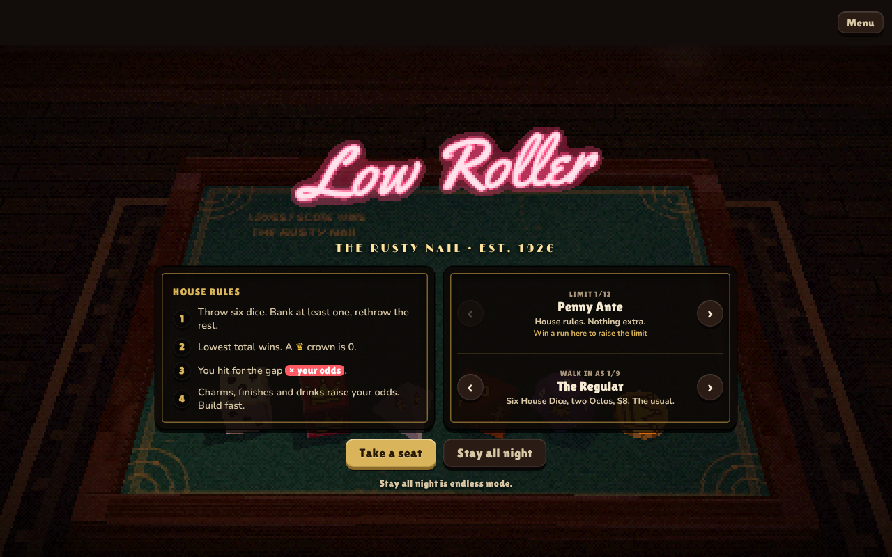
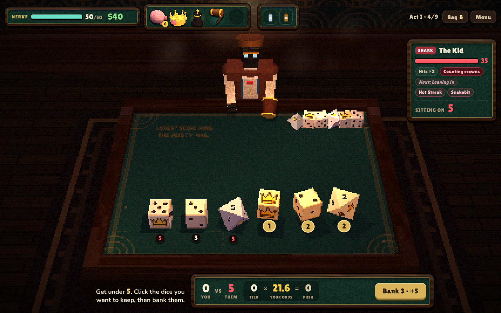
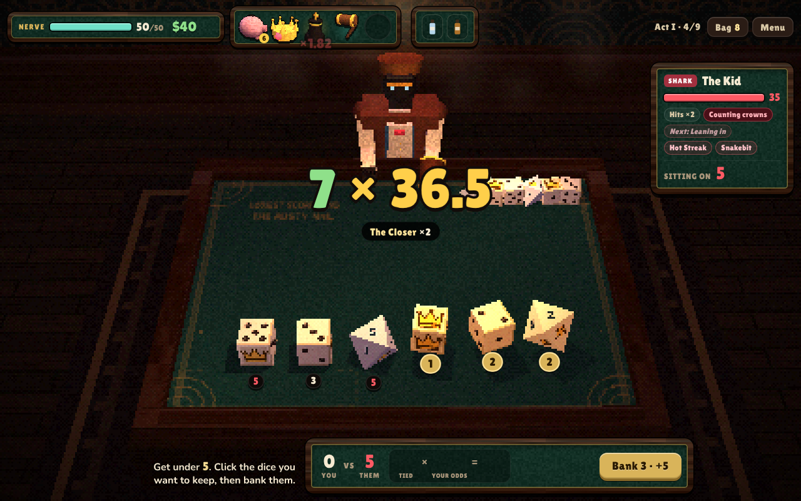
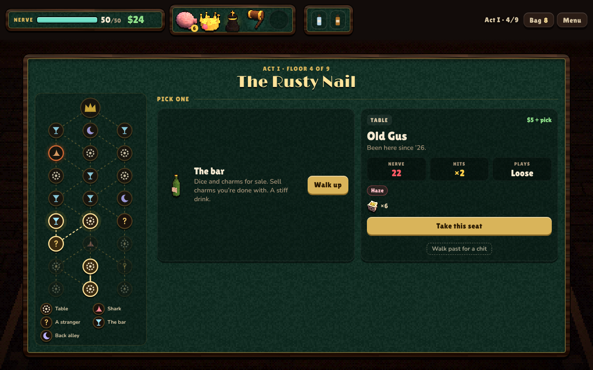
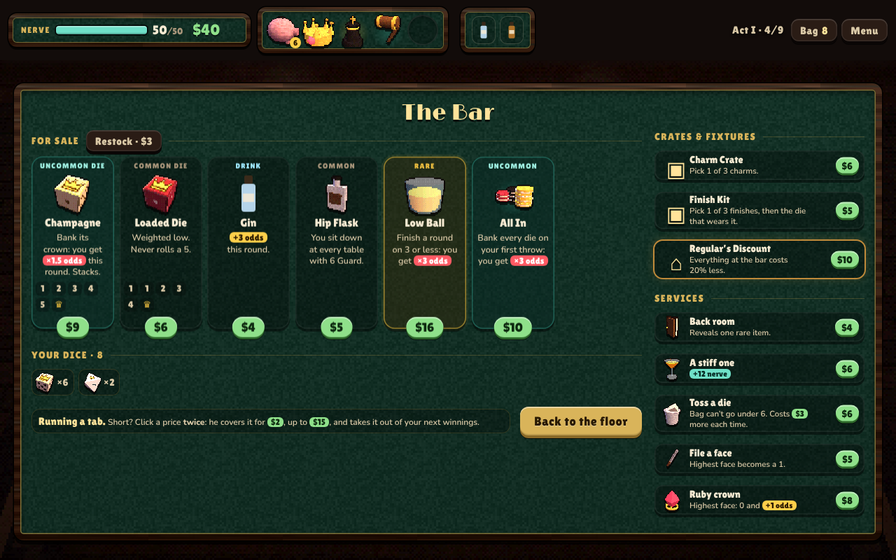

# Low Roller

**A speakeasy dice roguelike. Lowest total wins.**

You walk into a 1920s gambling den with a bag of dice and fifty nerve. Three rooms, three owners, one night. Beat the
table, buy charms at the bar, build a bag of dice that rolls low, and take the joint.

This README is the player's guide: how a round works, how hits are counted, every system, and every charm, die and
opponent in the game (those tables are generated from the code, so they're always current: `node tools/readme.js`).

---

## Contents
1. [The basics](#the-basics)
2. [How a round works](#how-a-round-works)
3. [Hits: margin × odds](#hits-margin--odds)
4. [Plays](#plays)
5. [Guard](#guard)
6. [Your opponent: Hits, tags and intents](#your-opponent-hits-tags-and-intents)
7. [The floor plan](#the-floor-plan)
8. [The bar, Last call and the alley](#the-bar-last-call-and-the-alley)
9. [Charms](#charms)
10. [Dice](#dice)
11. [Finishes, fixtures, crates, drinks, chits](#finishes-fixtures-crates-drinks-chits)
12. [Owners and deeds](#owners-and-deeds)
13. [Limits and pockets](#limits-and-pockets)
14. [Tips and strategy](#tips-and-strategy)
15. [Everything, listed](#everything-listed)
16. [For developers](#for-developers)

---

## The basics
- It's based on a bar dice game where the **lowest total wins**.
- A **crown ♛ scores 0**. A ruby crown also scores 0 and adds +1 odds when you bank it.
- You and your opponent each have **nerve** (health). Win a round and you hit them; lose one and they hit you.
- A run is **three acts** (the Rusty Nail, the Velvet Room, the Back Room), **nine floors each**, ending with that room's owner.
  Beat the third owner and you win the night. *Stay all night* (endless) keeps going, harder every lap.
- Between fights you shop, rest and meet strangers. Everything you buy stays for the whole run.

## How a round works
1. **You draw six dice** from your bag (your bag holds more than six; the rest wait).
2. **They throw first.** Their total is the number to beat, shown as *Sitting on* on their nameplate.
3. **You throw.** Pick at least one die and **bank** it. Banked dice are locked in; the rest get thrown again.
4. Keep throwing and banking until every die is banked. Your banked total is your score.
5. **Lower total wins.** A tie is a push: nobody gets hit.

The slip at the bottom shows the round live: *you vs them*, and *ahead by × your odds = what they lose*.
Click the slip any time for the full breakdown of your odds.

## Hits: margin × odds
**Win a round:** you hit for **margin × your odds**.
- **Margin** = how far under them you finished, plus anything that widens a win (Plays, Dealer's Cut, Haymaker).
- **Odds** start at 1. Charms, finishes, drinks, Plays and reputation **add** to it (+) first, then × effects **multiply** the total.

**Lose a round:** they hit you for **how far over you were × their Hits** (their odds, shown on the nameplate).

Every owner you beat gives **Reputation +1 odds** for the rest of the night. When a hit is bigger than what they had left,
the **overkill pays $1 per 10** (up to $10).

## Plays
Some banks are **Plays**. Each one you make in a round **adds its level to your margin and adds odds**:

| Play | How to make it | Odds per level |
|---|---|---|
| Pair of Ones | Bank two 1s in one go. | +1 |
| Three of a Kind | Bank three of the same face in one go. | +2 |
| The Ladder | Bank a 1, a 2 and a 3 in the same round. | +2 |
| Crown Court | Bank 3 or more crowns in a round. | +3 |
| Clean Hands | Finish a round on 3 or less. | +2 |

Every Play starts at level 1. **Every 4th time you make one it levels up** for the rest of the night. The back alley's
*Run the numbers* also levels your most-made Play. Your levels, and how close each Play is to its next level, are in Menu → Your Night.

## Guard
**Guard** soaks hits before your nerve does, and unlike a drink it **stays between rounds** at a table (it resets when you
sit down somewhere new). It only loses what it soaks. Build it with Hip Flask, The Bulldog, The Bodyguard and the
Protection Racket deed; Haymaker turns it into bigger wins. Your Guard shows under your score on the slip.

## Your opponent: Hits, tags and intents
Their **nameplate** (top right) has everything, top to bottom:
- **If they win a round: gap ×N**: how hard their wins land on your nerve (their Hits). It climbs every act.
- **This round / Next round**: what they're up to, in plain words. Green means it helps you, red means it hurts you. You see next round's coming so you can plan your drinks.
- **Their tricks**: their tags. **Tap one** to read it.
- **Plays Tight / Loose**: Tight only keeps 1s and crowns; Loose keeps anything 2 or under.
- **Tags (quirks)**: their special rules (list below).
- **House rules (counters)**: bosses and sharks draw one at random each night, built to punish one kind of build.

| Intent | What it does |
|---|---|
| Steady | Playing it straight. |
| Leaning in | If they win, they hit you 1 harder. |
| Sweating | If they win, their hit is halved. |
| Counting crowns | Your crowns score 1 on your first throw. |
| Getting tired | Their score counts 2 higher. |
| On tilt | Win the round: you get ×2 odds. |

**Bosses** have a signature move printed on their door, and get worse at half nerve. **No boss loses more than half their
nerve in one round**, so you always see their second half. One **burning door** per room is a high-stakes shark: 40% more
nerve, hits 1 harder, pays a rare charm.

## The floor plan
Each room is drawn up front. Climb from the bottom row to the owner at the top, **one row at a time along the lines**.

| Stop | What happens |
|---|---|
| Table | A regular. Pays $5 and a pick of spoils (a die or two commons). |
| Shark | Tougher, hits harder, draws a house rule. Pays $10 and a pick of uncommons. Beat one in 2 rounds or less for a chit. |
| Burning shark | High stakes: +40% nerve, +1 Hits. Pays $15 and a rare. |
| A stranger | An event: a choice, a deal or a gamble. |
| The bar | The shop. Two or three a room. |
| Back alley | Rest, or get a die worked on. |
| The owner | The boss. Pays $20, a rare, Reputation +1 and a deed. |

Floors 5 and 8 are always a choice between the bar and the back alley. From floor 2 on you can **walk past** a table
for a chit instead of fighting. **Tap a stop to see which card it is; tap again to go.**

## The bar, Last call and the alley
**The bar** sells dice, charms (sometimes a silver *Off the Books* charm that doesn't take a slot) and drinks, plus:
- **Restock** the shelf (price climbs each time), **crates** (open one, keep one), and **one fixture per room** (permanent).
- **Services:** the back room (reveals a rare), a stiff one (+12 nerve), **toss a die** ($6, then $3 more each time; the bag never goes under 6),
  **file a face** (highest face becomes a 1), **ruby crown** (highest face becomes a ruby crown).
- **Running a tab:** short on cash? Click a price twice and he fronts the rest for $2, up to $15. It comes out of your next winnings.

**Last call:** after every table the bartender offers one drink and a stiff one, so you can patch up between bars.

**The back alley:** catch your breath (heal 40%), have a House Die loaded, sand an Octo down to a House Die,
*Run the numbers* (+1 level to your most-made Play), or *Get a die marked* (Marked finish, −5 max nerve).

## Charms
Charms sit in your rack at the top and are **always working**. You hold **five** (six with the Back Booth fixture or The Still deed).
Tap a charm to read it or sell it for half. **Drag a charm to any slot** to move it. Order only matters for **The Mimic**: it copies whatever charm sits right of it, so that charm works twice (a little purple arrow on The Mimic and a purple ring on the copied charm show it, and both pulse when it fires). A few charms don't do more twice: Pair of Jacks, Lucky Penny, Deuces Wild, Sleight of Hand and Near Miss.
Rarer charms tend to multiply. The full list is in [Everything, listed](#everything-listed).

## Dice
Your bag is your deck. Six dice come out each round. Better dice have more low faces and crowns; **Octos** (eight sides) mostly roll high.
Toss the bad ones at the bar, file their high faces down, or crown them. Full list below.

## Finishes, fixtures, crates, drinks, chits
**Finishes** (one per die, shown as a glowing rim):
| Finish | Effect |
|---|---|
| Polished | Bank it: you get +2 odds this round. |
| Gold Leaf | Bank it showing a 1 or a crown: you get $1. |
| Lucky | Bank it: 1 in 3 chance of +4 odds this round. |
| Chrome | Bank it: you get ×1.25 odds this round. |
| Featherweight | Its 1s score 0. |
| Marked | Bank it: everything that counts its face counts it twice (crowns, 1s, Plays, charms). |

**Fixtures** (one is offered at the bar each room; yours for good):
| Fixture | Price | Effect |
|---|---|---|
| Back Booth | $14 | You can hold 6 charms instead of 5. |
| Regular’s Discount | $10 | Everything at the bar costs 20% less. |
| Second Shelf | $10 | The bar stocks 4 charms instead of 3. |
| Standing Order | $8 | Your first restock at every bar is free, and each costs $1 less. |
| Bigger Crates | $8 | Crates hold 4 picks instead of 3. |
| Lucky Felt | $15 | You get +1 odds, always. |
| Expensive Taste | $10 | Rare charms and dice turn up twice as often. |
| Cooked Books | $10 | Off the Books charms turn up three times as often. |
| Velvet Rope | $12 | +8 max nerve, and you heal 8 now. |
| Wall Safe | $9 | Win a fight: you get $1 per $10 you’re holding (up to $5). Stacks with Savings Bond. |

**Crates:**
| Crate | Price | Effect |
|---|---|---|
| Charm Crate | $6 | Pick 1 of 3 charms. |
| Dice Crate | $5 | Pick 1 of 3 dice. Some come finished. |
| Finish Kit | $5 | Pick 1 of 3 finishes, then the die that wears it. |

**Drinks** ride in your coat (two at most). Tap one on your turn; it lasts the round. Bourbon and a Sidecar work any time.
| Drink | Price | Effect |
|---|---|---|
| Gin | $4 | +3 odds this round. |
| Absinthe | $6 | ×2 odds this round. |
| Soda Water | $4 | The opponent’s score counts 2 higher this round. |
| Bitters | $4 | If you lose this round, their odds count as 1. |
| Bourbon | $4 | Heal 10 nerve. |
| Sidecar | $3 | $6, right now. |

**Chits** are small favors, earned by beating a shark quickly or walking past a table:
| Chit | Effect |
|---|---|
| Cash Chit | $5, right now. |
| Comp | The next charm you buy at the bar is free. |
| Free Crate | The next bar has a free Charm Crate on the counter. |
| Tip-off | The next bar has a rare charm on the shelf. |
| Under the Table | The next bar’s first charm is Off the Books. |
| Polish Job | A random die in your bag gets a random finish, right now. |
| Double or Nothing | Your next table pays double. |
| Stiff Drink | Heal 10 nerve, right now. |

## Owners and deeds
| Room | Owner | Who | Signature | At half nerve |
|---|---|---|---|---|
| The Rusty Nail | Big Sal | The owner. Beat her and the Nail is yours. | Once she’s at half nerve, she slams the table on your first throw each round: your two best dice get rerolled. | No more smiles: Sal adds Haze and plays tight |
| The Rusty Nail | Mama Rosa | Runs the kitchen. Every round she wins, she heals what she took. | Every round she wins, she heals what she hit you for. | Second helpings: Rosa adds Hot Streak |
| The Velvet Room | The Countess | She runs the room upstairs. Every round she swaps one of your dice for an Octo. | Swaps one of your dice for an Octo every round (two at half nerve). | The gloves come off: Two swaps a round, and House Edge |
| The Velvet Room | Zambini | A stage magician. One of your dice lands face-down every throw. | One of your dice lands face-down every throw. Two at half nerve. | For my next trick: Two dice hidden, and Copycat |
| The Back Room | The House | Nobody’s seen his face. Ties go to the house. | Every tie goes to the opponent and hits you for 2. | The house always wins: Haze, and he plays tight |
| The Back Room | The Chief | Every third round is a raid: your odds drop to 1. | Every third round is a raid and your odds drop to 1. Every other round at half nerve. | Up against the wall: Raids every other round, and Sharp |

Each room has two possible owners, picked at random every night.

**Deeds:** beat an owner and you can take the deed to one of their rackets: strong, with a catch, for the rest of the night.
| Deed | What it does |
|---|---|
| The Still | +1 charm slot. Everything at the bar costs $2 more. |
| Protection Racket | You sit down at every table with 10 Guard. Tables pay $2 less. |
| Brass Plate | No round takes more than 12 nerve from you. −10 max nerve. |
| Deep Pockets | You draw 7 dice a round. Rounds you lose hit you 2 harder. |
| Bad Reputation | +3 odds for good. Everyone you face has 15% more nerve. |
| The Black Book | Your Plays multiply: each one you make gives ×1.5 odds instead of its + odds. |

## Limits and pockets
Beat the house to raise the **limit**. Each one stacks on every limit below it.
| # | Limit | Adds |
|---|---|---|
|  | Penny Ante | House rules. Nothing extra. |
| 1 | Nickel | Everyone you face has 10% more nerve. |
| 2 | Dime | Bosses bring an extra quirk. |
| 3 | Quarter | Everything at the bar costs $1 more. |
| 4 | Half Dollar | You walk in with 5 less nerve. |
| 5 | Silver Dollar | The Act III owners hit 1 harder. |
| 6 | Card Sharp | Sharks throw one die face-down. You only see it after your first bank. |
| 7 | Lead Slug | One of your House Dice is a cursed Lead Die: 1 1 2 3 4 5, never a crown. It can’t be tossed. |
| 8 | Gold Eagle | Sharks bring an extra quirk too. No breather on the stairs. |
| 9 | Last Orders | The bar shelf holds one charm less, and restocks cost double. |
| 10 | The Big Board | Everyone has 12% more nerve. Tables pay $2 less. |
| 11 | Double Down | Beat the last owner and the other one sits down right after, at three-quarter nerve. No breather. |

**Pockets** are who you walk in as. Beating owners unlocks more.
| Pocket | Start | Unlocks after |
|---|---|---|
| The Regular | Six House Dice, two Octos, $8. The usual. | start |
| The Hustler | $22 in your pocket, but only 45 nerve. | 1 owners beaten |
| The Collector | Two House Dice come Polished and Lucky. $4. | 2 owners beaten |
| The Gambler | Two High Rollers instead of Octos, and a Bent Spoon. | 3 owners beaten |
| The Bootlegger | Gin and Absinthe in your coat and $12, but only 45 nerve. | 4 owners beaten |
| The Jeweler | One House Die already has a ruby, but only $3 and rubies at the bar start at $10. | 5 owners beaten |
| The Mechanic | Lucky Felt already installed (+1 odds, always). No cash, no Octos. | 6 owners beaten |
| The Heavy | 55 nerve and Thick Skin, but only $2. | 8 owners beaten |
| The Ghost | Back Booth already installed (6 charm slots), but only 40 nerve. | 10 owners beaten |

## Tips and strategy
- **Bank crowns and 1s first.** A crown is a free 0. With few dice left, take what's low and stop chasing.
- **Read their number before you commit.** If they sit on 12, you can afford to bank a 3; if they sit on 2, you need crowns.
- **Build in two directions.** Odds (+ first, then ×) make your wins huge; low-score effects (Lucky Penny, The Ringer,
  Sleight of Hand, filed faces, ruby crowns) make you *win more rounds*. The best runs have both.
- **Thin your bag.** Toss Octos early. The fewer bad dice you own, the more often your good ones come out (but tossing gets pricier).
- **Use the intents.** Drink your Absinthe on an *On tilt* round; save your Bourbon for after a *Leaning in*.
- **Route on purpose.** Plan to hit a bar when your pockets are full and an alley before the owner. Sharks pay better but bite.
- **Guard wins long fights.** Against bosses and anything with Bloodlust or Second Wind, a few rounds of Guard is worth more than odds.
- **Plays snowball.** Pick one or two you make naturally (Pair of Ones with Boxcars or Viper; Crown Court with crown dice) and lean in.
- **Mind the house rules.** Flat Rate turns off ×; The Vig halves your odds; Jinx benches a charm each round. Have a plan B.

## Everything, listed
### Charms (67)
| Charm | Rarity | Price | What it does |
|---|---|---|---|
| Consolation | Common | $4 | Lose a round: you get $2 (not when Rabbit’s Foot takes the hit). |
| Crown Jewels | Common | $6 | You get +1 odds per crown you bank. |
| Dealer's Cut | Common | $5 | When you win a round, your “ahead by” counts 2 higher. |
| Even Money | Common | $5 | You get +2 odds per 2, 4 or 6 you bank. |
| Glassblower | Common | $5 | You get +2 odds per Glass Die you bank. Your Glass Dice last 2 more rounds. |
| Gold Tooth | Common | $5 | You get $1 per crown you bank. |
| Hip Flask | Common | $5 | You sit down at every table with 6 Guard. |
| Hot Hand | Common | $5 | You heal 1 nerve per crown you bank. |
| Iron Liver | Common | $6 | You get +12 max nerve. |
| Near Miss | Common | $5 | You lose a round by exactly 1: nobody gets hit. |
| Opening Act | Common | $6 | Your first round at each table: you get ×2 odds. |
| Packed House | Common | $6 | You get +1 odds per 2 dice in your bag. |
| Restless | Common | $5 | Grows +2 odds every time you restock the bar. Never resets. |
| Savings Bond | Common | $6 | Win a fight: you get $1 per $10 you’re holding (up to $5). |
| Shiner | Common | $5 | Finish a round without banking a crown: you get +6 odds. |
| Slow Burn | Common | $6 | You get +1 odds per round you’ve won in a row at this table. |
| The Collection | Common | $5 | You get +4 odds per charm you hold (this one too). |
| Thick Skin | Common | $5 | Rounds you lose hit you 3 less (at least 1). |
| Three’s Company | Common | $5 | You get +2 odds per 3 you bank. |
| Ticket Stub | Common | $5 | You get +2 odds per chit you’ve earned this run. |
| Tip Jar | Common | $5 | You get $2 for every round you win. |
| Victory Cigar | Common | $5 | You heal 6 nerve after every fight you win. |
| All In | Uncommon | $10 | Bank every die on your first throw: you get ×3 odds. |
| Bar Fly | Uncommon | $9 | You get +1 odds per $6 you’re holding. |
| Bent Spoon | Uncommon | $9 | Once per round: pick one of your dice and reroll it. |
| Blood Money | Uncommon | $8 | You get +6 odds. You lose 1 nerve every round (never your last). |
| Bump the Table | Uncommon | $8 | Once per table, after they throw: click Bump and their lowest die gets thrown again. |
| Crate Rat | Uncommon | $7 | Grows +3 odds every crate you open. Never resets. |
| Deuces Wild | Uncommon | $9 | Your 2s score 1. |
| Double Take | Uncommon | $8 | Every 1 you bank counts as two 1s (for Snake Eyes and Pair of Ones). |
| Jackpot | Uncommon | $9 | Bank three of a kind in one go: you get ×2 odds this round. |
| Loaded Thumb | Uncommon | $9 | Twice per table: click Nudge, then a die in your tray, to turn it down by 1. Crowns don’t move. |
| Long Shot | Uncommon | $8 | Win a round by 1 or 2: you get ×2.5 odds. |
| One at a Time | Uncommon | $10 | Bank exactly one die every throw for a whole round: you get +4 odds. |
| Pair of Jacks | Uncommon | $9 | In each bank you make, repeat faces score 0. (3, 3, 5 counts as 3 + 0 + 5.) |
| Piggy Bank | Uncommon | $8 | Grows +2 odds every round you win. Breaks back to 0 when you lose one (unless Rabbit’s Foot takes the hit). |
| Rabbit's Foot | Uncommon | $9 | The first round you lose at each table doesn’t hurt you. |
| Shoeshine | Uncommon | $8 | Your finished dice give +2 more odds when you bank them. |
| Short Stack | Uncommon | $9 | You get +2 odds per die your bag is short of 9. |
| Snake Eyes | Uncommon | $9 | You get +1 odds per 1 you bank. |
| Tally Card | Uncommon | $8 | You get +1 odds per 2 fights you’ve won while holding this. |
| The Bodyguard | Uncommon | $9 | You get +3 Guard every round you win. |
| The Bouncer | Uncommon | $10 | The opponent’s score counts 1 higher, so you win ties. Doesn’t make your hits bigger. |
| The Bulldog | Uncommon | $8 | You get +1 Guard for every 1 you bank. |
| The Closer | Uncommon | $12 | Win a round by 5 or more: you get ×2 odds. |
| The Curator | Uncommon | $8 | You get +2 odds per die in your bag with a finish. |
| The Echo | Uncommon | $9 | Crowns you bank on your first throw of a round count as two crowns each. |
| The Finisher | Uncommon | $9 | Opponent at half nerve or less: you get ×2.5 odds. |
| The Heckler | Uncommon | $10 | Your first crown each round adds 1 to the opponent’s score. |
| The Regular | Uncommon | $9 | You get +1 odds per round already played at this table. |
| Tommy Gun | Uncommon | $8 | You get +2 odds per die in your final bank each round. |
| Big Shot | Rare | $16 | You get ×1.2 odds per charm you hold (this one too). |
| Double Down | Rare | $16 | Won your last round at this table: you get ×3 odds. |
| Haymaker | Rare | $15 | You sit down at every table with 4 Guard. Win a round: you win it by 1 more per Guard you have. |
| High Stakes | Rare | $15 | You get ×2 odds, but rounds you lose hit you 1 harder. |
| Kingpin | Rare | $18 | You get ×1.35 odds per crown you bank. Stacks. |
| Last Call | Rare | $16 | Your final bank each round: its highest die counts 1 less, if it’s a 4 or more. |
| Low Ball | Rare | $16 | Finish a round on 3 or less: you get ×3 odds. |
| Lucky Penny | Rare | $17 | Your first throw each round: your 1s score 0. |
| Moonshine | Rare | $16 | Ferments: gains ×0.05 odds every round you win. Never resets. |
| Rabbit Punch | Rare | $15 | Your Lucky dice hit every time, and give +6 instead of +4. |
| Sleight of Hand | Rare | $15 | Your first throw each round: every die that lands on 5 or more gets one free rethrow. |
| Straight Shooter | Rare | $15 | Bank a 1, a 2 and a 3 in the same round: you get ×5 odds. |
| The Bookie | Rare | $15 | Win a round: you get $1 per point you won by, up to $8. |
| The Crown Room | Rare | $16 | Bank 3 or more crowns in a round: you get ×3 odds. |
| The Mimic | Rare | $15 | Copies whatever the charm to its right does, so it works twice. Drag charms to set the order. |
| The Ringer | Rare | $17 | Your crowns score −1 instead of 0, but your 1s score 3. |

### Dice (22)
| Die | Rarity | Price | Faces | Notes |
|---|---|---|---|---|
| Boxcars | Common | $6 | 1 1 1 6 6 ♛ | Three 1s, two 6s. Pairs well with Snake Eyes. |
| Deuce | Common | $5 | 2 2 2 2 3 ♛ | Four 2s. Pairs with Deuces Wild. |
| Glass Die | Common | $5 | 1 1 1 2 ♛ ♛ | Great faces, but it shatters after you draw it for 3 rounds. |
| Goose Egg | Common | $5 | 0 4 5 6 6 ♛ | One face is 0. The rest run high. |
| High Roller | Common | $6 | 1 2 3 4 5 6 7 8 9 10 11 ♛ | Mostly awful. Bank its crown: you get ×2 odds this round and $3. |
| House Die | Common | $4 | 1 2 3 4 5 ♛ | The standard die. A crown scores 0. |
| Loaded Die | Common | $6 | 1 1 2 3 4 ♛ | Weighted low. Never rolls a 5. |
| Octo | Common | $3 | 1 2 3 4 5 6 7 ♛ | Eight sides. Usually rolls high. |
| Champagne | Uncommon | $9 | 1 2 3 4 5 ♛ | Bank its crown: you get ×1.5 odds this round. Stacks. |
| Cherry Bomb | Uncommon | $8 | 1 2 3 4 5 ♛ | Bank its crown: the opponent loses 8% of their max nerve on the spot (at least 2). |
| Devil's Die | Uncommon | $9 | -1 2 3 4 5 ♛ | One face is −1: it takes a point off your score. |
| Ember | Uncommon | $7 | 1 2 3 4 5 6 ♛ ♛ | Two crowns on eight sides. Bank a crown: you get +2 odds this round. |
| Gilded Die | Uncommon | $9 | 1 2 3 4 5 ♛ | Bank its crown: you get $2. |
| Payday | Uncommon | $7 | 1 2 3 4 5 ♛ | Bank its 1: you get $1. |
| Pebble | Uncommon | $10 | 1 2 3 ♛ | Four sides, all low. |
| Trick Die | Uncommon | $8 | -1 3 6 6 6 ♛ | Half the time it’s a 6. The −1 takes a point off your score. |
| Lucky Coin | Rare | $15 | 1 ♛ | Only ever a 1 or a crown. |
| Royal Die | Rare | $13 | ♛ ♛ ♛ 4 5 6 | Three crowns, three high faces. Feast or famine. |
| Shaved Die | Rare | $16 | 1 1 2 2 ♛ ♛ | Two 1s, two 2s, two crowns. |
| Twin | Rare | $11 | 1 2 3 4 5 ♛ | Copies your lowest other die in the same throw. |
| Viper | Rare | $12 | 1 1 ♛ 5 6 6 | Bank its 1: you get ×1.5 odds this round. Stacks. |
| Lead Die | Cursed | – | 1 1 2 3 4 5 | Cursed: it never shows a crown, and you can’t toss it. |

### Opponent tags
| Tag | What it does |
|---|---|
| Cold Table | Your first throw each round: your crowns score 1 instead of 0. |
| Short Fuse | Your first throw each round: you must bank at least 2 dice. |
| Haze | Your first throw each round: one of your dice lands face-down until you bank it. |
| Sticky Fingers | The opponent takes $3 from you every round they win. |
| House Edge | The opponent’s score counts 1 lower every round. |
| Nervous Wreck | The opponent loses 1 nerve every round, win or lose. |
| Holds a Grudge | Once the opponent is at half nerve, rounds they win hit you 2 harder. |
| Hot Streak | Each round the opponent wins in a row hits you 1 harder than the last. |
| Cover Charge | Every round at this table costs you $1. |
| Heavy Hand | Every round the opponent wins, you draw an extra die next round. |
| Copycat | Bank any crown in a round and the opponent’s score drops by 1. |
| Sharp | Ties go to the opponent. |
| Three Sheets | The opponent’s score counts 1 higher every round. |
| Two Heads | Both twins throw. The opponent keeps the lower total. |
| Loudmouth | Your odds count 2 lower (never under 1). |
| No Royals | Your crowns score 1 instead of 0. |

### House rules (counters)
| House rule | What it does |
|---|---|
| Iron Jaw | No single round can take more than a third of the opponent’s max nerve. |
| Flat Rate | Your × odds don’t count here. Only + odds. |
| The Vig | Your odds are cut in half (rounded down, never under 1). |
| Jinx | Each round, one of your charms is switched off. |
| Bulletproof Vest | The first round you win at this table does no damage. |
| Bloodlust | The opponent’s odds go up by 1 every other round of the fight. |
| Second Wind | The opponent gets back 3% of their max nerve after every round. |
| Snakebit | Your first throw each round: your 1s score 2. |
| Brass Knuckles | Every round you win, a tenth of the damage comes back at you (1 to 5). |

### Regulars and sharks
| Act | Kind | Name | Who | Plays | Tags |
|---|---|---|---|---|---|
| Act I | Table | Mopey Earl | Regular. Sad about it. | Loose | Nervous Wreck |
| Act I | Table | Twitchy Dee | Rolls before you sit down. | Loose | – |
| Act I | Table | Old Gus | Been here since ’26. | Loose | Haze |
| Act I | Table | Nickels | Owes everybody five bucks. | Loose | Cover Charge |
| Act I | Table | Granny Mae | Knits between throws. | Loose | Three Sheets |
| Act I | Table | Sleepy Joe | Nods off between throws. | Loose | Three Sheets |
| Act I | Table | Tipsy Tina | Hand in your pocket. | Loose | Sticky Fingers |
| Act I | Table | Lefty | Deals with his right. | Loose | Cold Table |
| Act I | Table | Dutch | Bets the deed. | Loose | Holds a Grudge |
| Act I | Table | Slim | All elbows. | Loose | Short Fuse |
| Act I | Table | Hattie | Hands like anchors. | Loose | Heavy Hand |
| Act I | Table | Kitty | Copies everything you do. | Loose | Copycat |
| Act I | Shark | Knuckles | Bouncer. Off the clock. | Loose | Short Fuse |
| Act I | Shark | The Kid | Too young to be in here. | Loose | Hot Streak |
| Act I | Shark | Pearl | Never blinks. | Loose | Haze, Sticky Fingers |
| Act I | Shark | The Twins | Finish each other’s rolls. | Loose | Two Heads |
| Act I | Shark | Smiley | Grins the whole time. | Loose | Sharp, Cover Charge |
| Act I | Shark | Lenny | Never shuts up. Never. | Loose | Loudmouth, Hot Streak |
| Act II | Table | Silky Vince | Smells like money. | Loose | Cover Charge |
| Act II | Table | Madame Ora | Already knows your roll. | Loose | Haze |
| Act II | Table | Dot | Sells smokes, steals change. | Loose | Sticky Fingers, Nervous Wreck |
| Act II | Table | Fingers | Counts cards. Wrong game. | Loose | Sticky Fingers |
| Act II | Table | Velma | Sings between rounds. | Loose | Heavy Hand |
| Act II | Table | Dapper Dan | Tie straight. Odds straighter. | Loose | Sharp |
| Act II | Table | The Professor | Counts on his fingers. Fast. | Tight | Short Fuse |
| Act II | Table | Vito | Smiles with his mouth only. | Tight | House Edge |
| Act II | Table | Mr. Velvet | Named the room after himself. | Tight | Cold Table, Hot Streak |
| Act II | Table | Rocco | Breaks thumbs on weekends. | Tight | Holds a Grudge, Cover Charge |
| Act II | Table | Sister Grace | Prays for your dice. | Loose | Haze, House Edge |
| Act II | Table | Miss Fortune | Reads your dice before they land. | Tight | Copycat, Haze |
| Act II | Shark | Lady Chance | Wears your luck as a necklace. | Tight | Sticky Fingers, Haze, Hot Streak |
| Act II | Shark | Iron Pete | Never blinks first. | Tight | Short Fuse, Sharp |
| Act II | Shark | The Doubles | Back for your wallet. | Tight | Two Heads, Sticky Fingers |
| Act II | Shark | Madame Noir | Plays with a stranger’s money. | Tight | Cold Table, Cover Charge |
| Act II | Shark | The Magpie | Anything shiny. | Tight | Sticky Fingers, Copycat |
| Act III | Table | Specs | Counts your breaths. | Tight | House Edge, Holds a Grudge |
| Act III | Table | Miss Ruby | Collects debts. | Tight | Sticky Fingers |
| Act III | Table | Tony Twice | Never says anything once. | Tight | Haze, Hot Streak |
| Act III | Table | Benny Blue | Plays the horn. Badly. | Tight | Cold Table, Cover Charge |
| Act III | Table | The Judge | Overrules your dice. | Tight | Sharp, Nervous Wreck |
| Act III | Table | Officer Kelly | On the take. On the clock. | Tight | Loudmouth, Cover Charge |
| Act III | Table | Inky Lou | Writes your name down. | Tight | Short Fuse, Cover Charge |
| Act III | Table | The Widow | Third husband this year. | Tight | Cold Table, Haze |
| Act III | Table | Bruno | Doesn’t play. Collects. | Tight | House Edge, Heavy Hand |
| Act III | Table | Lola | Wears her winnings. | Tight | Sticky Fingers, Hot Streak |
| Act III | Table | Mack | Takes a cut of every pot. | Loose | Copycat, Cover Charge |
| Act III | Table | Lucky Lucy | Has never lost a tie. | Tight | Sharp, Hot Streak |
| Act III | Shark | The Enforcer | Cracks his knuckles between throws. | Tight | Short Fuse, Sticky Fingers, Heavy Hand |
| Act III | Shark | The Undertaker | Measures you for a box. | Tight | Holds a Grudge, Heavy Hand, Cold Table |
| Act III | Shark | Doc | Sews up the losers. Charges extra. | Tight | Sharp, Holds a Grudge, Haze |
| Act III | Shark | The Ledger | Nobody leaves owing. | Tight | House Edge, Haze |
| Act III | Shark | Dolores | Buys the table, then the room. | Tight | Loudmouth, Sticky Fingers |

---

## For developers
- `src/js/logic.js` holds the rules (data + pure functions, `require`-able from Node); `src/js/game.js` is everything else.
- `node tools/bundle.js` builds the single-file web version (`dist/low-roller.html`) that's published as a private Claude artifact.
- Checks: `node tests/logic.test.js` (rules), `node tests/sim/check-balance.js` (balance gate with the bots),
  `QUICK=1 python3 tests/e2e/run_all.py` (browser checks). Bots: `node tests/sim/sim.js n=300 skill=pro|good|mid lim=0`.
- `node tools/readme.js` rebuilds this README from the code. CLAUDE.md has the working rules.
